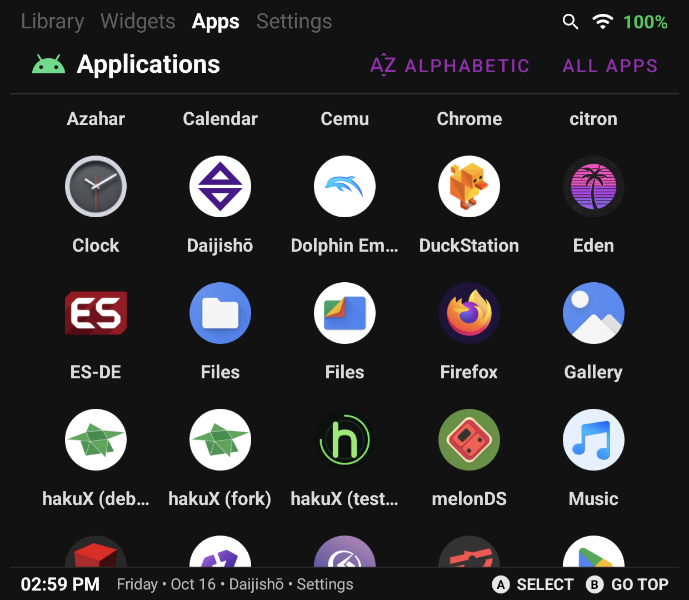

# Daijishō

Last updated 2026-10-16.

Daijishō starts hakuX CE from its **Apps** tab. There is nothing to set up:
hakuX CE is an ordinary installed app, so Daijishō already lists it. You do
not need to create a platform.

| | |
|---|---|
| Frontend | Daijishō 1.8.1 |
| Device | Thor, Android 13 |
| hakuX CE | 0.5.x release build, package `com.jreinach.hakux` |

## Add hakuX CE as an app

1. Install hakuX CE and open it once, so Android knows the app exists.
2. Open Daijishō and go to the **Apps** tab (top bar: Library, Widgets,
   **Apps**, Settings).
3. Scroll to **hakuX CE**. The list is alphabetical.
4. Tap it. hakuX CE opens on its own Game Library.
5. Pick a game and press Play.

If hakuX still shows an old name such as "hakuX (fork)", that is Daijishō's
cached app list from before the rename. It is the same app; the label updates
the next time Daijishō rebuilds its list.

## What to expect

hakuX CE opens to its own Game Library, not to a specific game. Daijishō's
Apps tab can only start an app; it cannot hand over a game file. You choose
the game inside hakuX CE, and from there Play reaches the game's boot
screen.

Closing hakuX CE and tapping it in the Apps tab again works the same way.

## Notes

- Daijishō's own Library and platform editor (Settings > Library > New
  platform) are not needed for this and were not used.
- Last checked on the Thor on 2026-10-16: tapping the Apps entry launched
  `com.jreinach.hakux/com.rfandango.haku_x.LauncherActivity`, and a game
  booted at about 29 FPS, both from a cold start and after fully closing
  hakuX CE.
- Other launchers: see [the frontend index](README.md).
