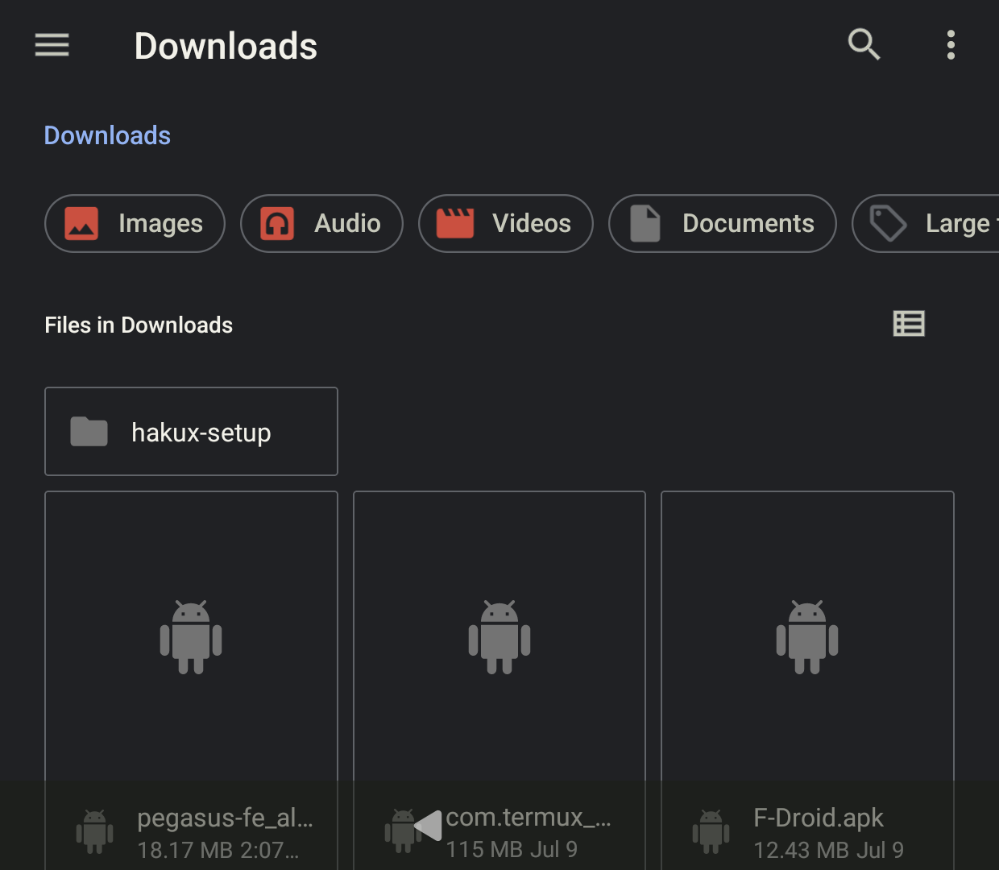
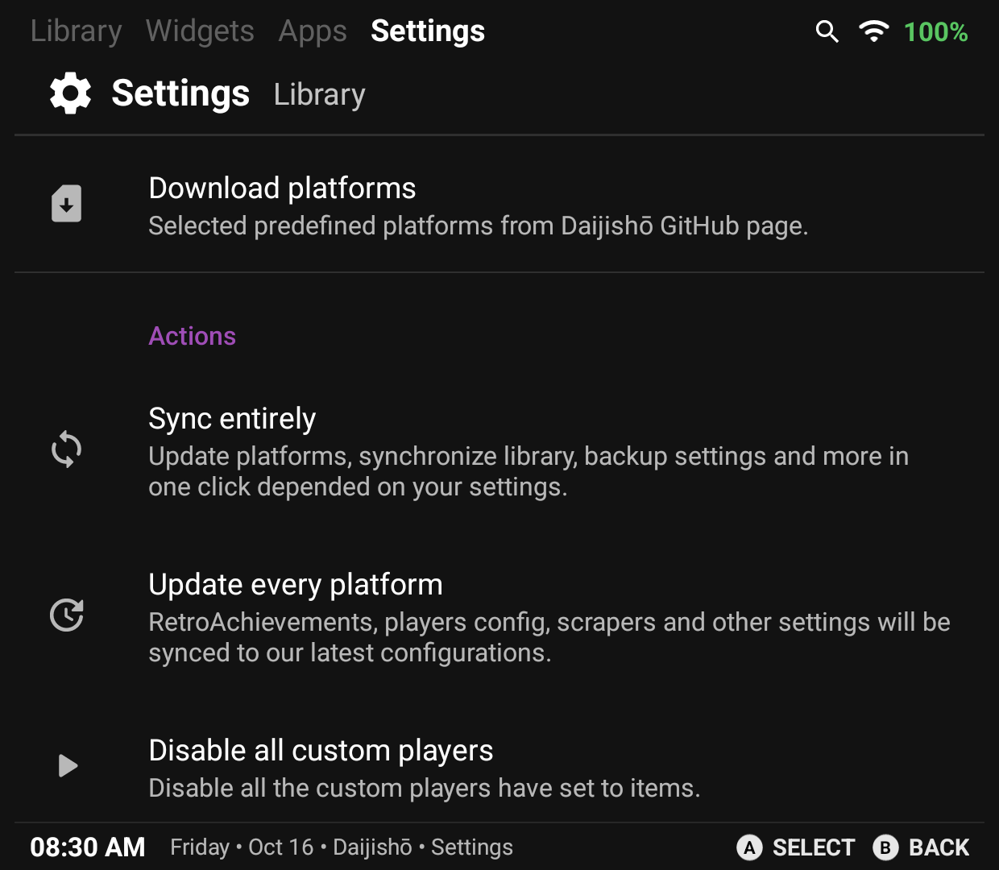

# Daijishō

## Daijishō (Thor) — tested on the Thor

| | |
|---|---|
| Frontend | Daijishō, `com.magneticchen.daijishou`, version 1.8.1 (versionCode 426) |
| Device | Thor (AYN handheld), Android 13 (SDK 33) |
| hakuX | 0.5.0-1016-2636e89f4a, package `com.jreinach.hakux` (release build, "hakuX CE") |

A prior lane tried to wire Daijisho up through its custom "Platform" editor
and got blocked on the "Default player" field (see "What was tried and
ruled out" below). This lane found a working integration elsewhere in
Daijisho's own UI and did not need to solve that field at all.

### Config

None needed. Daijisho has its own **Apps** tab (top nav: Library / Widgets /
**Apps** / Settings) — a generic Android app list, the same kind of
mechanism as Pegasus's built-in "Android" collection (see
[`pegasus.md`](pegasus.md)). hakuX CE shows up there under its installed
display name, alongside every other installed app:

(The label still reads "hakuX (fork)" here — this is Daijisho's own cached
app-list label from before the owner's 2026-10-16 rename to "hakuX CE",
same as the stale label seen in Pegasus's list. The package and activity
are unchanged.)

Tapping the icon launches `com.jreinach.hakux/com.rfandango.haku_x.LauncherActivity`
directly — confirmed via `dumpsys activity recents` — no selection step first
(unlike Pegasus, a single tap both selects and launches here).

### Steps

1. Open Daijisho. Go to the **Apps** tab.
2. Scroll to find hakuX CE (shown as "hakuX (fork)" until Daijisho's app
   list cache catches up with the rename) among the installed apps.
3. Tap it once. This opens hakuX's own Game Library screen.
4. Pick a game from the list and press its play control.
5. Confirmed twice, each from Daijisho's own UI (not adb):
   - **Cold**: tapped the icon from a fresh Daijisho session. Opened to
     `GameLibraryActivity`; picking `41540002-Shin_Megami_Tensei_Nine` and
     pressing Play took focus to `MainActivity` and rendered the Atlus
     splash at 29 FPS.

     

   - **After fully closing hakuX**: ran `am force-stop
     com.jreinach.hakux`, returned to Daijisho's Apps tab, and tapped the
     icon again. Same result — Game Library, then the Atlus splash at
     29 FPS on Play.

     

### What a successful launch looks like

Same shape as every other frontend in this directory: tapping hakuX CE in
Daijisho's Apps tab opens hakuX's own Game Library (not a specific game),
and picking a game from inside hakuX reaches that game's splash/boot
screen.

### Known limits / findings

- **The Apps tab launches the app, not a specific game.** Same limitation
  as Pegasus's Android collection and the stock launcher: a generic
  "launch this installed app" entry has no way to pass a ROM path as an
  argument. The user picks the game from inside hakuX.
- **Intermittent DocumentsUI-recovery glitch, not tied to one frontend.**
  Across four force-stop-then-relaunch attempts this lane made through
  Daijisho and Pegasus combined, two landed cleanly on hakuX's Game
  Library and two instead opened Android's `DocumentsUI` Files app at the
  device's Downloads folder:

  

  `dumpsys activity recents`/`activities` confirmed this is hakuX's own
  `LauncherActivity` re-triggering some games-folder recovery/re-grant
  flow on a fresh cold start, not a problem caused by whichever frontend
  did the launching. Backing out (one or two presses of Back, observed
  both) and launching again always reached the Game Library cleanly on the
  next attempt. Recorded as a finding for whoever next touches hakuX's
  Setup Wizard / SAF-permission code — out of scope for this lane to fix.
- Daijisho's custom "Platform" editor (Settings > Library > New platform)
  remains a second, unused path — see below. It was not needed once the
  Apps tab worked, and this lane did not revisit the "Default player"
  keyboard problem further once the simpler route worked. Android code
  changes remain out of scope for this lane; no NEED: was required because
  nothing here needed a hakuX-side change.

## What was tried and ruled out (prior lane, custom Platform editor)

This section is kept for the next lane that might want a fuller
integration (a dedicated hakuX "platform" entry with its own icon/metadata
in Daijisho's Library, instead of the generic Apps-tab entry above) — not
because it's needed to launch hakuX today.

The goal was a custom "Platform" entry in Daijisho pointing its `launch`
command at `com.jreinach.hakux/com.rfandango.haku_x.LauncherActivity`, the
same activity ES-DE's find rule and the Apps tab both use.

Settings > Library > **"New platform"** opens a dialog with RetroAchievements
and Player-settings sections, including a **"Default player"** autocomplete
field plus CANCEL/SAVE.

Typing a value into "Default player" that matches a real option, then
pressing SAVE, is rejected: **"Please select from the list."** The field
requires an actual tap-selection from Daijisho's own in-app suggestion
dropdown, not typed text — however exact. That dropdown is believed to
render underneath the fullscreen/extracted IME keyboard this device uses for
text entry on a small landscape screen: the suggestion list would normally
anchor right below the field, but the whole screen goes black-keyboard while
typing, and no suggestion list has ever been visible in any screenshot taken
mid-type. This lane did not re-attempt a keyboard-dismissal fix (back key /
hardware d-pad / controller) or a file-import route for this field, since
the Apps tab above already satisfied the brief's "launched from Daijisho's
own UI" requirement — the first working route stops the search, per the
brief.

Three other routes to platform creation were checked and ruled out by the
prior lane:
- **Settings > Library > "Download platforms"** — a 122-item checkbox list
  of predefined platforms with an IMPORT button. This is a bulk-import flow
  for known platforms, not a custom-platform editor, and the list is slow to
  scroll (short swipes barely move it; a long 2000 ms swipe didn't move it
  further and also triggered this device's screen-sleep bug).
- **Settings > Library > "Inspect platforms"** — read-only, lists the
  already-configured platforms, no add control.
- **The Library tab's platform-card carousel** — swiped all the way
  through on the hypothesis that a trailing "+ Add platform" card might
  exist past the last real platform. It does not; it wraps back around.

### Automation note

`adb shell uiautomator dump` fails against Daijisho every time, with
`ERROR: null root node returned by UiTestAutomationBridge.` — it does not
expose a standard Android accessibility tree (it's Flutter-rendered, not
native views). Screenshot + coordinate-tap is the only automation method
that works here.
