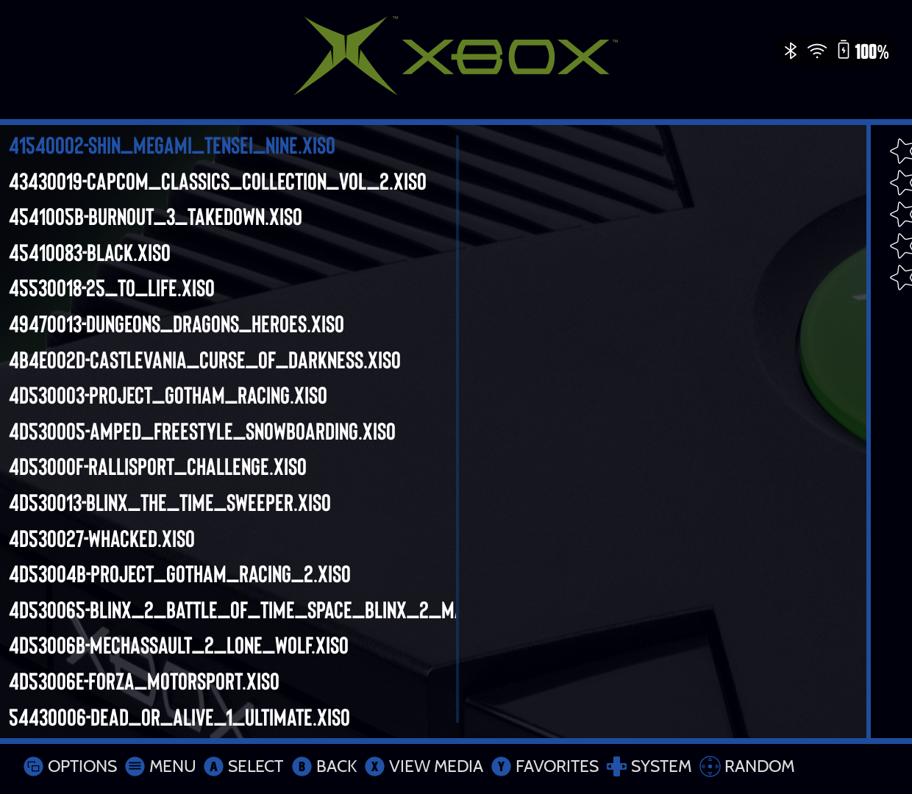
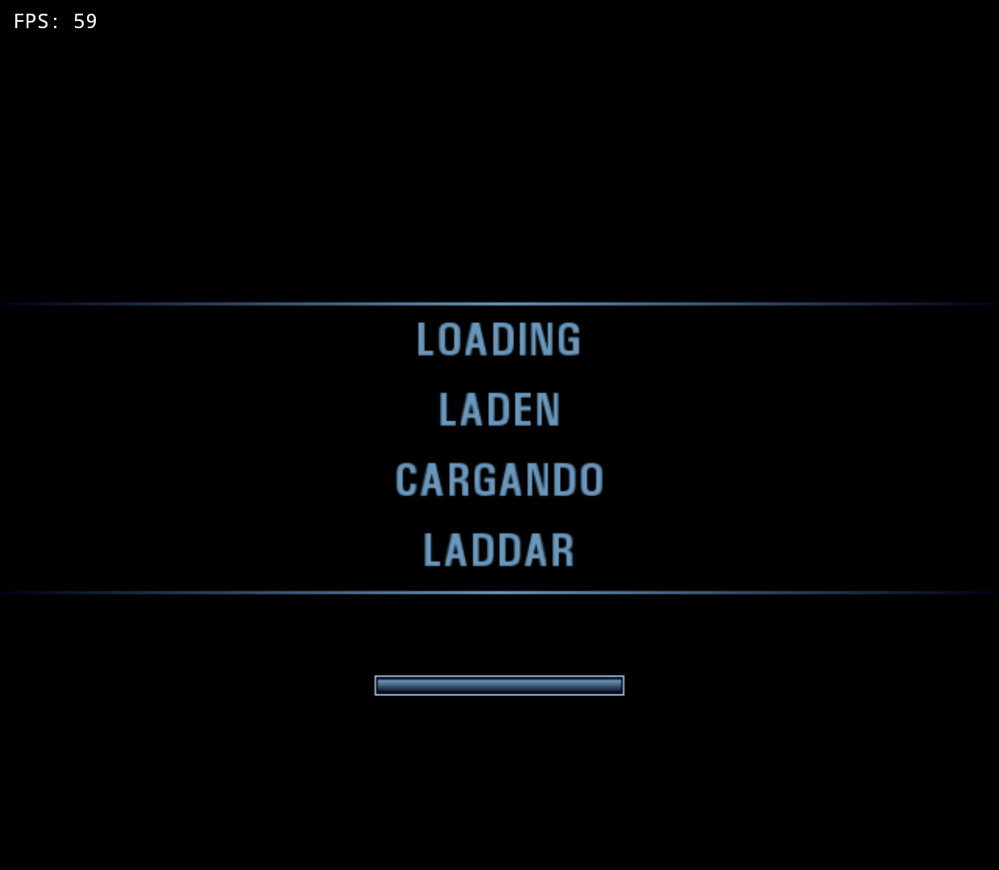

# ES-DE

**Status: tested on the Thor.**

| | |
|---|---|
| Frontend | ES-DE, version 3.4.0-56 |
| Device | Thor (AYN handheld), Android 13 (SDK 33) |
| hakuX | 0.4.1-1004-40b62fd533, package `com.jreinach.hakux` |

## Config

ES-DE needs two files in its `custom_systems` folder, already in this repo
at [`docs/es-de/es_find_rules.xml`](../es-de/es_find_rules.xml) and
[`docs/es-de/es_systems.xml`](../es-de/es_systems.xml). Full install steps,
including what to do if you already have your own custom ES-DE files, are in
[`docs/es-de/README.md`](../es-de/README.md) — this page only records what
was verified when those steps were actually run on a device.

On the Thor, ES-DE's real data folder turned out to be on the SD card at
`/storage/<card-id>/ES-DE/`, not the empty `/storage/emulated/0/ES-DE/`
folder that also exists on this device — if you don't see your pushed files
take effect, check you found the live one (look for `settings/es_settings.xml`
inside it, not just a folder named `ES-DE`).

## Steps that were actually run

1. Pushed `es_find_rules.xml` and `es_systems.xml` into
   `<ES-DE data folder>/custom_systems/` with `adb push`.
2. Force-stopped ES-DE (it wasn't running) and relaunched it.
3. Opened the Xbox system — it found 41 titles immediately in `ROMS/xbox`
   (uppercase `ROMS`, lowercase `xbox`), matching the shipped
   `%ROMPATH%/xbox` path with no `ROMDirectory` override needed.

   

4. Selected `4541005B-Burnout_3_Takedown.xiso.iso` (2.87 GB, already on the
   card) and pressed the default select action.

## What a successful launch looks like

Selecting a game and pressing select hands off to
`com.jreinach.hakux/com.rfandango.haku_x.LauncherActivity` — confirmed via
`dumpsys activity activities` showing the activity focused within about a
second of the keypress.

Launched twice from ES-DE's own UI (D-pad + confirm, not adb intents), to
catch a first-launch-only path:
1. **First launch:** hakuX's `MainActivity` took focus, the Criterion Games
   splash rendered at 59 FPS.
2. **Second launch**, after a full `am force-stop com.jreinach.hakux`: also
   succeeded, and got further — past the splash into the game's own
   "LOADING / LADEN / CARGANDO / LADDAR" screen, still at 59 FPS.

   

Quitting the game returns to ES-DE, per the standard ES-DE emulator exit
behavior (not independently re-verified on this pass).

## Known limits

None found. The existing drafts in `docs/es-de/` turned out to be correct
as written — this page's contribution was turning "untested hypothesis"
into "verified on hardware."
