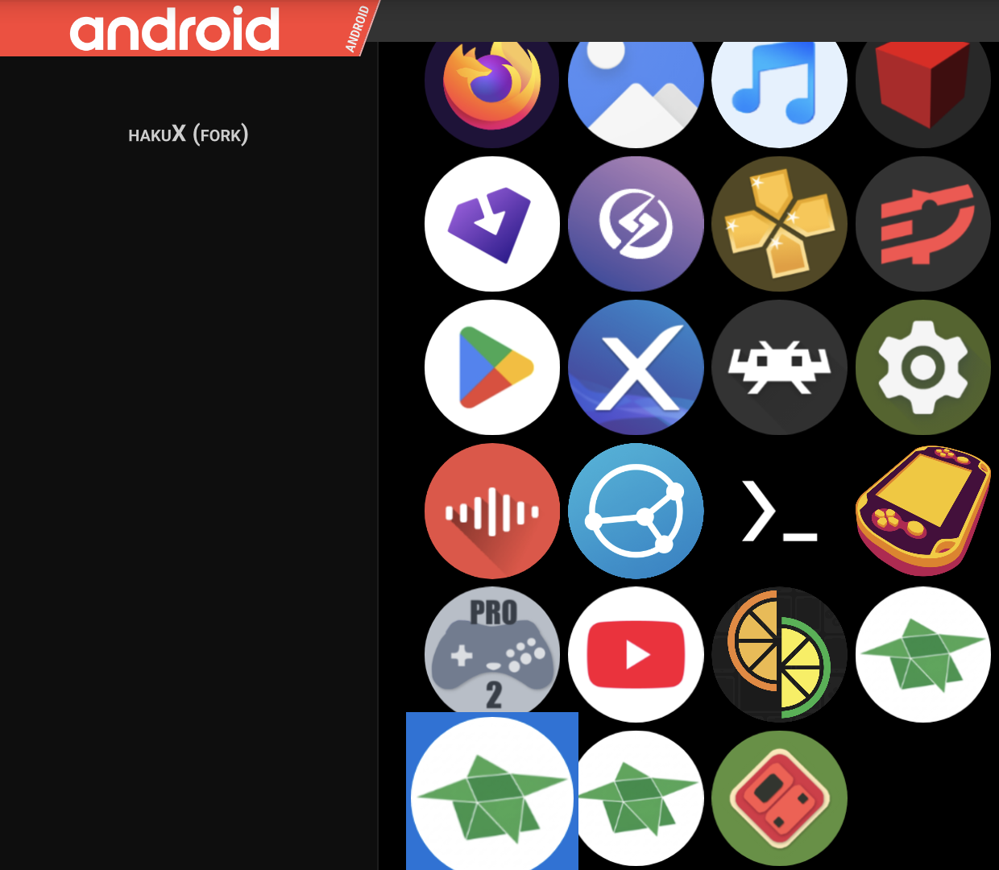
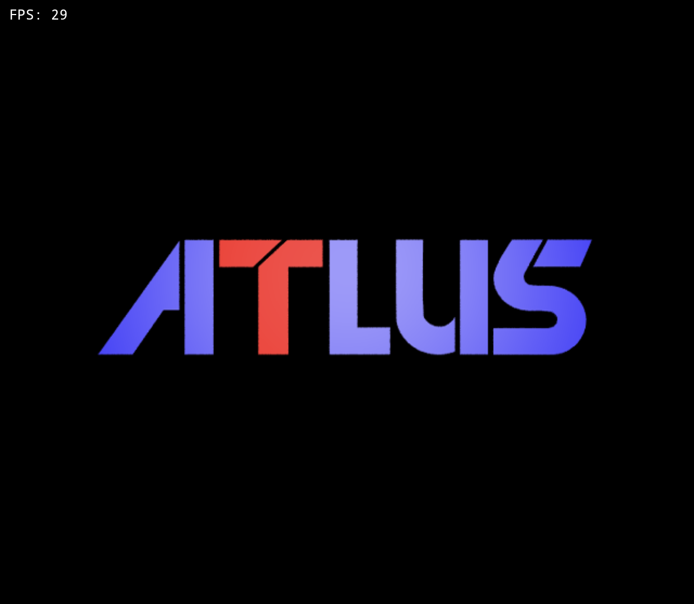
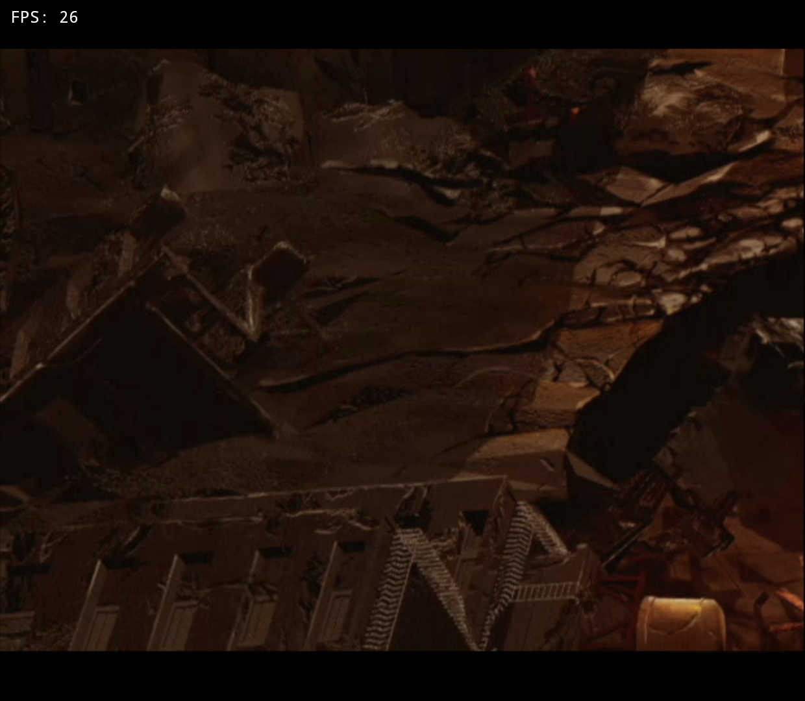

# Pegasus

## Pegasus (Thor) — tested on the Thor

| | |
|---|---|
| Frontend | Pegasus, `org.pegasus_frontend.android`, versionName `alpha16-82-gc3462e68`, versionCode 1945 |
| Device | Thor (AYN handheld), Android 13 (SDK 33) |
| hakuX | 0.5.0-1016-2636e89f4a, package `com.jreinach.hakux` (release build, "hakuX CE") |

### Config

None needed. Pegasus ships a built-in **Android** collection that lists every
launchable app installed on the device — it is not a per-game metafile with a
hand-written `launch:` command, it is Pegasus reading the device's own app
list the same way a launcher's app drawer does. hakuX CE shows up in that
grid under its display name:

(This screenshot was taken before the owner's 2026-10-16 rename from
"hakuX (fork)" to "hakuX CE" took effect in Pegasus's cached app list; the
package and activity targeted are unchanged — see
[`docs/lanes/frontends1016/NOTES.md`](../lanes/frontends1016/NOTES.md) for
every place the old display name appears.)

Selecting the icon confirms it targets hakuX's real exported entry point:
`dumpsys activity recents` shows the launched task's intent as
`cmp=com.jreinach.hakux/com.rfandango.haku_x.LauncherActivity` — the same
component the stock launcher and ES-DE use, not an adb-only shortcut.

### Steps

1. Open Pegasus. Navigate to the **Android** collection.
2. Tap the hakuX icon once to select it (shown in the left detail panel).
   A single tap only *selects* the item — it does not launch it.
3. Press the confirm/accept button (`DPAD_CENTER` on a controller, or the
   Thor's equivalent button) to actually launch it.
4. Confirmed twice, each from Pegasus's own UI (not adb):
   - **Cold**: selected hakuX from a fresh Pegasus session and launched it.
     It opened to `GameLibraryActivity`; picking
     `41540002-Shin_Megami_Tensei_Nine` and pressing Play took focus to
     `MainActivity` and rendered the Atlus splash at 29 FPS.

     

   - **After fully closing hakuX**: ran `am force-stop
     com.jreinach.hakux`, returned to Pegasus (still showing hakuX selected
     in the detail panel), and launched it again the same way. It again
     opened to `GameLibraryActivity`; picking the same game and pressing
     Play reached the game running at 26 FPS.

     

### What a successful launch looks like

Selecting hakuX in Pegasus's Android collection and confirming opens hakuX's
own Game Library screen, the same entry point the stock launcher reaches —
Pegasus has no mechanism to target a specific game file through its generic
Android-app launch path, only the app itself. From there, picking a game and
pressing play reaches that game's own splash/boot screen, same as every
other frontend tested in this directory.

### Known limits / findings

- **Pegasus's Android collection launches the app, not a specific game.**
  Same limitation as the stock launcher (see
  [`stock-launcher.md`](stock-launcher.md)): a generic "launch this
  installed app" entry has no way to pass a ROM path as an argument the way
  ES-DE's custom system does. The user always picks the game from inside
  hakuX.
- **One-time transient glitch, self-resolved**: on the very first attempt to
  re-launch hakuX from Pegasus immediately after completing hakuX's own
  Setup Wizard (Finish → Game Library) and then force-stopping it, the next
  launch from Pegasus landed on Android's `DocumentsUI` folder picker
  instead of hakuX's Game Library — `dumpsys activity recents` confirmed
  this picker was opened by hakuX's own `LauncherActivity` in the same task,
  not a stray leftover window, so this was hakuX re-running its
  games-folder recovery flow rather than a Pegasus problem. Backing out
  (`KEYCODE_BACK` twice) and launching again from Pegasus a second time
  worked cleanly and went straight to the Game Library, confirming the
  Games Folder permission grant was in fact persisted correctly and this
  was a one-off hiccup, not a reproducible block. Recorded here as a
  finding rather than silently retried out of the record.
- Pegasus has no offline documentation on the Thor beyond its own on-screen
  UI; per this lane's rules, nothing was fetched from
  `pegasus-frontend.org` or GitHub to write this page — everything above
  was confirmed by driving the device.
