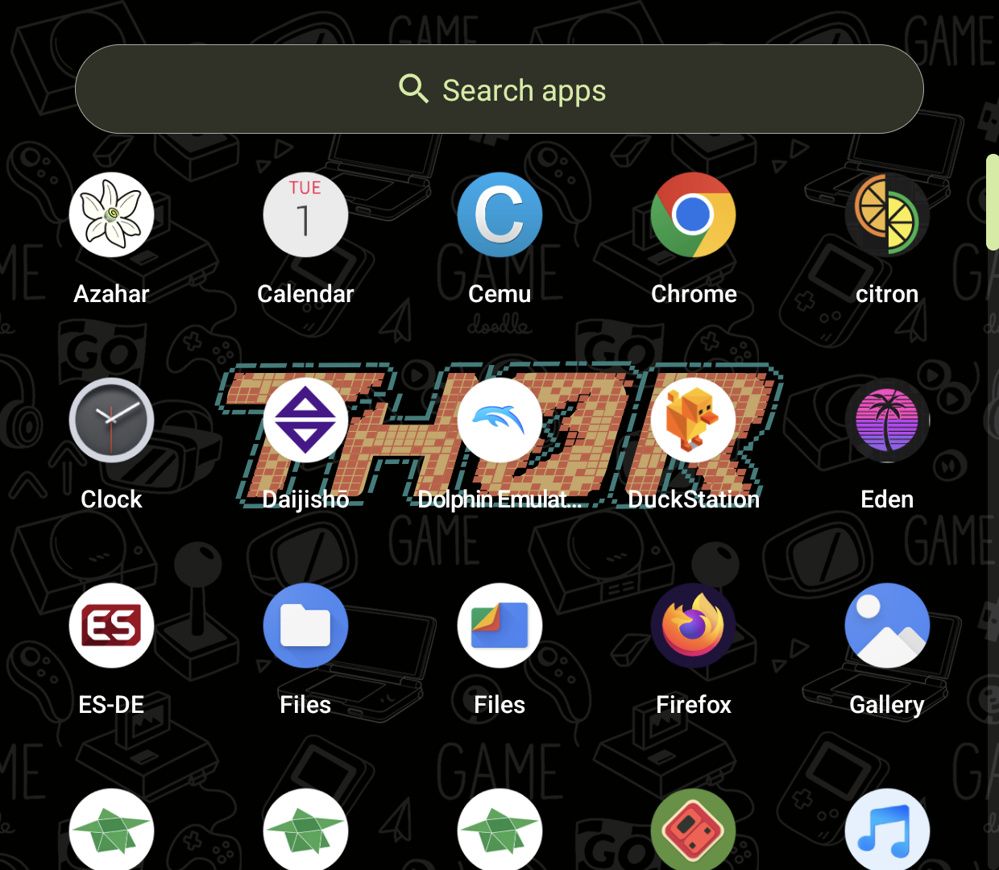
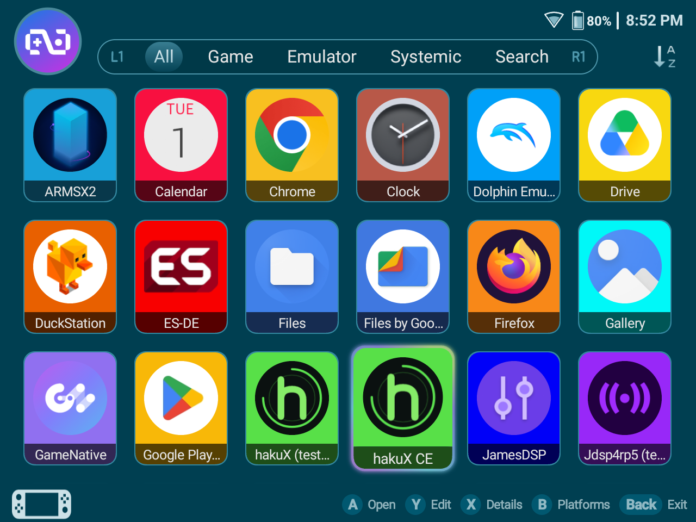

# Stock launcher

## AYN odinlauncher (Thor) — tested on the Thor

| | |
|---|---|
| Frontend | AYN odinlauncher, `com.odin.odinlauncher` |
| Device | Thor (AYN handheld), Android 13 (SDK 33) |
| hakuX | 0.4.1-1004-40b62fd533, package `com.jreinach.hakux` |

### Config

None needed. hakuX already shows up in the stock launcher's app drawer and
search under its display name, same as any installed Android app:

Searching "hakuX" surfaces all three installed variants — the release build
("hakuX CE"), `.debug`, and `.debug2`. Only the release build
("hakuX CE") was tested here.

### Steps

1. From the home screen, open Search apps, type "hakuX", tap **hakuX CE**.
   This starts the app's default launcher activity,
   `com.jreinach.hakux/com.rfandango.haku_x.GameLibraryActivity` — confirmed
   via `dumpsys activity activities`.
2. hakuX opens to its own in-app Game Library. Pick a game from the list and
   press its play control.
3. Confirmed twice: once from a cold start, once after a full
   `am force-stop com.jreinach.hakux` followed by re-opening the app the same
   way (tap the icon in search again). Both times the tap landed on
   `GameLibraryActivity`, and selecting `41540002-Shin_Megami_Tensei_Nine`
   both times took focus to `MainActivity` and rendered the Atlus splash at
   29 FPS.

   

### What a successful launch looks like

Tapping the app icon opens hakuX's own Game Library screen (not a specific
game) — this is expected for a stock Android launcher, see "Known limits"
below. From there, picking a game and pressing play reaches the game's own
splash/boot screen.

### Known limits

A stock Android launcher has no mechanism to scan a ROM folder or pass a
specific game file as a launch argument the way ES-DE's custom system or a
Daijisho platform definition can — it only knows how to start an app's
default activity. So the stock launcher can only ever open hakuX's own
in-app Game Library; the user always picks the specific game from inside
hakuX, not from the launcher itself. This is a property of generic Android
launchers, not something this wiring could change.

## Retroid launcher (Nova) — tested on the Nova

| | |
|---|---|
| Frontend | RetroidLauncher, `com.retroidpocket.gamelauncher/.activities.RpGameLauncher` |
| Device | Nova (Retroid handheld), 1280x960 screen |
| hakuX CE | 0.5.1-rc1, package `com.jreinach.hakux` |

### Config

None needed. hakuX CE is listed in the launcher's **Apps** screen under its
display name:

(A second tile, "hakuX (test…", is a developer debug build. Players will
only see **hakuX CE**.)

### Steps

1. On the launcher's platform screen, press **B** (Apps). Touch only moves
   the focus on this launcher; the D-pad moves it and **A** opens.
2. Move the focus to **hakuX CE** and press **A**.
3. hakuX CE opens on its own Game Library. Pick a game and press Play.
4. The pause menu works and **Exit** returns to the Game Library.

Checked on the Nova on 2026-10-16: a cold start after a full force-stop, a
game booting at 59 FPS, the pause menu, and Exit. No crash or hang.

The launcher's **Games** tab shows "No games found". It lists only the
systems the Retroid launcher knows about, and hakuX CE is started from
**Apps**, not from there.

### Switching the home app

Which launcher is the home app does not change how hakuX CE runs. The test
above switched the Nova's home app from ES-DE to the Retroid launcher and
back with the package manager (`adb shell cmd package set-home-activity
<package>/<activity>`), not through Settings. Android's own Home app setting
(Settings > Apps > Default apps) does the same thing, but its exact menu
path varies by device and was not tried here.
